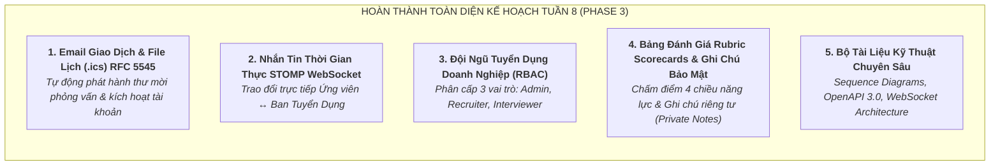
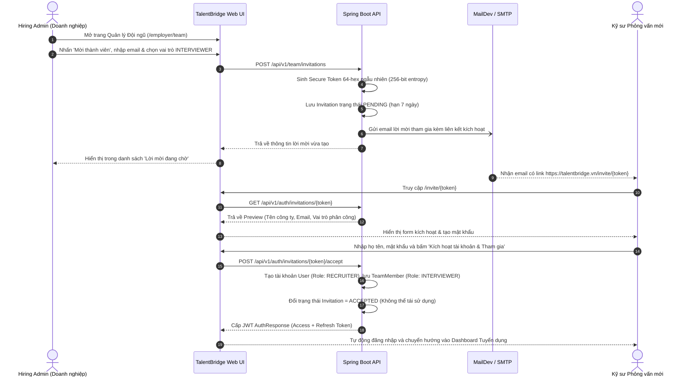
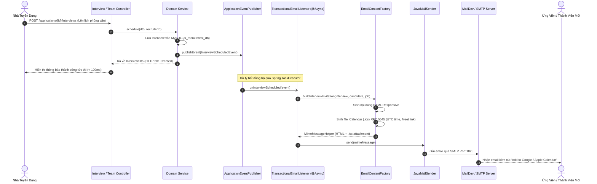
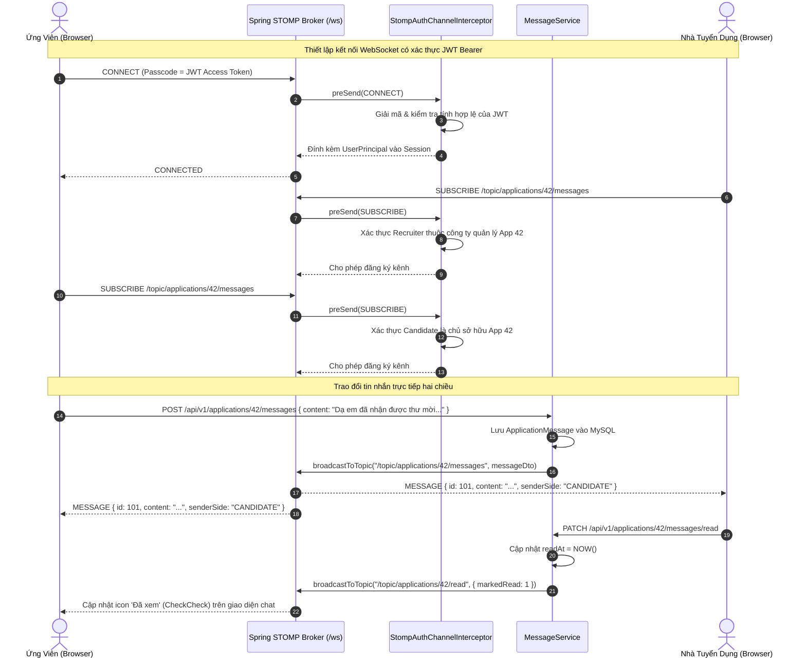
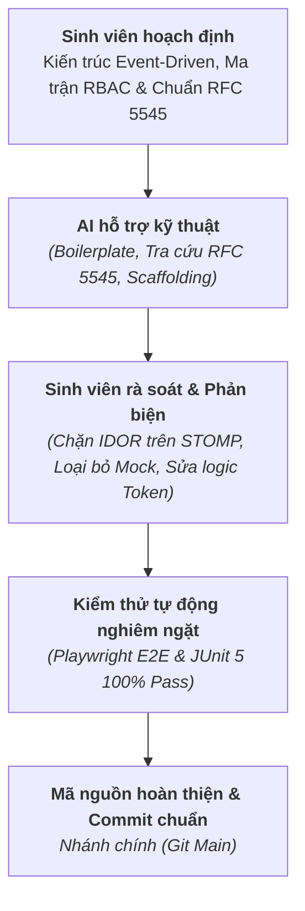

# BÁO CÁO TIẾN ĐỘ TUẦN 8
**Đề tài:** Nền tảng Tuyển dụng Đa ngành nghề & Quản lý Quy trình Tuyển dụng Doanh nghiệp (TalentBridge)  
**Nội dung thực hiện:** Xây dựng Hệ thống Email Giao dịch Bất đồng bộ & Sinh tệp Lịch (.ics RFC 5545), Kênh Nhắn tin Thời gian thực STOMP over WebSocket, Phân hệ Đội ngũ Tuyển dụng Doanh nghiệp (RBAC Admin/Recruiter/Interviewer), Bảng Đánh giá Năng lực Rubric Scorecards, Ghi chú Nội bộ Bảo mật (Private Notes) và Kiểm thử Tự động E2E 100% Pass  
**Sinh viên thực hiện:** Vũ Minh Khang - 23110238  
**Thời gian báo cáo:** Tuần 8 - Tháng 10/2026 (Hoàn thiện Toàn diện Phase 3 Enterprise ATS)  
**Giảng viên hướng dẫn:** (Kính gửi Thầy/Cô Hướng dẫn)  

---

## 1. Mục tiêu tuần 8

Trong tuần 8, dự án **TalentBridge** đặt trọng tâm vào việc hoàn thiện toàn diện Phase 3, nâng cấp nền tảng từ quy mô quản lý đơn giản lên **hệ thống tuyển dụng và giao tiếp chuẩn doanh nghiệp (Enterprise-grade ATS & Communication Platform)**:



### Các mục tiêu cốt lõi đã đề ra:
1. **Triển khai Dịch vụ Email Giao dịch Tự động & Tích hợp Lịch `.ics` (RFC 5545)**:
   - Xây dựng kiến trúc gửi email bất đồng bộ (`@Async`) với Spring `ApplicationEventPublisher`, đảm bảo độ trễ phản hồi HTTP dưới 100ms.
   - Tự động sinh file iCalendar (`.ics`) chuẩn RFC 5545 đính kèm thư mời phỏng vấn, hỗ trợ thêm sự kiện với 1 chạm vào Google Calendar, Microsoft Outlook và Apple Calendar.
   - Thử nghiệm và xác thực tự động 100% qua MailDev v3 (SMTP: `1025`, Web/REST API: `1080`).
2. **Xây dựng Kênh Trao đổi Tin nhắn Thời gian thực STOMP over WebSocket (`/ws`)**:
   - Triển khai kết nối hai chiều full-duplex qua giao thức STOMP, xây dựng tầng bảo mật `StompAuthChannelInterceptor` ngăn chặn triệt để lỗ hổng rò rỉ dữ liệu (IDOR).
   - Xây dựng giao diện Dual-Pane chuyên nghiệp: danh sách hội thoại, xem trước tin nhắn, badge số tin chưa đọc trên Navbar, trạng thái đã xem (`CheckCheck`), phím tắt `Enter` gửi tin và `Shift + Enter` xuống dòng.
3. **Phát triển Phân hệ Đội ngũ Tuyển dụng Doanh nghiệp & Phân quyền RBAC Đa cấp**:
   - Phân cấp 3 vai trò rõ rệt: **Quản trị viên (ADMIN)**, **Chuyên viên tuyển dụng (RECRUITER)**, và **Người phỏng vấn kỹ thuật (INTERVIEWER)**.
   - Luồng mời thành viên bảo mật bằng Token ngẫu nhiên 256-bit (`/invite/:token`), tự đặt mật khẩu và tự động kích hoạt tài khoản.
   - Bảng chấm điểm phỏng vấn theo khung Rubric chuẩn hóa 4 chiều (Technical, Communication, Problem Solving, Culture Fit) cùng khuyến nghị tuyển dụng chuẩn Greenhouse (`STRONG_HIRE`, `HIRE`, `NEUTRAL`, `NO_HIRE`, `STRONG_NO_HIRE`).
   - Hệ thống ghi chú nội bộ phân cấp: Ghi chú toàn đội ngũ (Shared) và Ghi chú bảo mật riêng tư (Private - chỉ tác giả và Admin xem được).
4. **Xây dựng Các Trang Quản Trị Phỏng Vấn, Doanh Nghiệp & Bảo Mật Tài Khoản**:
   - Trang Lịch phỏng vấn tổng hợp (`/employer/interviews`): Quản lý toàn bộ các buổi hẹn sắp tới, định dạng trực tuyến/trực tiếp và danh sách người chấm điểm.
   - Trang Hồ sơ công ty (`/employer/company`): Cho phép nhà tuyển dụng trực tiếp biên tập thông tin giới thiệu, website, quy mô và địa chỉ trụ sở.
   - Tính năng Đổi mật khẩu an toàn (`/profile#security`) tại trang cá nhân với xác thực mật khẩu cũ và mã hóa BCrypt mật khẩu mới.
5. **Kiểm thử tự động hóa toàn diện (Automated Testing) & Xuất bản Tài liệu Kỹ thuật**:
   - Xây dựng mới bộ test E2E Playwright `test_phase_f_enterprise_flow.cjs` đạt **18/18 checks PASSED**, bảo đảm toàn bộ hệ thống đạt 100% test pass (8 test suites, 0 lỗi TypeScript, 0 lỗi console).
   - Xuất bản 4 tài liệu kỹ thuật đầy đủ sơ đồ tuần tự (Sequence Diagram), ma trận phân quyền và đặc tả REST/WebSocket API tại thư mục `docs/phase-3-implementation/`.

---

## 2. Các công việc đã hoàn thành

### 2.1. Phân hệ Đội ngũ Tuyển dụng Doanh nghiệp & Phân quyền RBAC Đa cấp

Cơ sở dữ liệu được nâng cấp qua bản Flyway migration `V2__hiring_team_interviews_messaging_email.sql` bổ sung 2 bảng `company_team_members` và `company_team_invitations`. Hệ thống thiết lập ma trận phân quyền chi tiết cho từng nghiệp vụ:

#### Bảng Ma trận Phân quyền Đội ngũ Tuyển dụng (RBAC Matrix):
| Hành Động Nghiệp Vụ | Quản Trị Viên (ADMIN) | Chuyên Viên Tuyển Dụng (RECRUITER) | Người Phỏng Vấn (INTERVIEWER) | Ứng Viên (CANDIDATE) |
| :--- | :---: | :---: | :---: | :---: |
| **Mời thành viên mới vào đội ngũ** | ✅ Có | ❌ Không | ❌ Không | ❌ Không |
| **Thay đổi vai trò / Vô hiệu hóa thành viên** | ✅ Có | ❌ Không | ❌ Không | ❌ Không |
| **Chỉnh sửa Hồ sơ Công ty (`/employer/company`)** | ✅ Có | ✅ Có | ❌ Không | ❌ Không |
| **Đăng tin / Sửa tin / Đóng tin tuyển dụng** | ✅ Có | ✅ Có | ❌ Không | ❌ Không |
| **Xem danh sách ứng viên & tải PDF CV** | ✅ Có | ✅ Có | ✅ Có (Chỉ xem) | ❌ Không |
| **Chuyển vòng ứng tuyển (Move Stages)** | ✅ Có | ✅ Có | ❌ Không | ❌ Không |
| **Lên lịch / Dời lịch phỏng vấn (.ics)** | ✅ Có | ✅ Có | ❌ Không | ❌ Không |
| **Xem lịch phỏng vấn cá nhân (`/employer/interviews`)** | ✅ Có | ✅ Có | ✅ Có | ❌ Không |
| **Chấm điểm bảng tiêu chí (Rubric Scorecard)** | ✅ Có | ✅ Có | ✅ Có | ❌ Không |
| **Tạo ghi chú chia sẻ chung (Shared Note)** | ✅ Có | ✅ Có | ✅ Có | ❌ Không |
| **Tạo & xem ghi chú riêng tư (Private Note)** | ✅ Xem tất cả | ✅ Chỉ của mình | ✅ Chỉ của mình | ❌ Không |
| **Trao đổi tin nhắn với ứng viên (`/messages`)** | ✅ Có | ✅ Có | ✅ Có | ✅ Có |



---

### 2.2. Dịch vụ Email Giao Dịch Tự Động & Sinh Tệp Lịch (.ics - RFC 5545)

Nhằm đảm bảo trải nghiệm tuyển dụng liền mạch chuẩn quốc tế, TalentBridge xây dựng hệ thống phát hành thư tự động kết hợp tệp đính kèm lịch theo quy chuẩn RFC 5545:



#### Quy chuẩn tệp sự kiện lịch (.ics - RFC 5545) được hệ thống sinh tự động:
```text
BEGIN:VCALENDAR
VERSION:2.0
PRODID:-//TalentBridge//Recruitment Platform//VI
CALSCALE:GREGORIAN
METHOD:REQUEST
BEGIN:VEVENT
UID:tb-interview-102@talentbridge.vn
DTSTAMP:20261010T163000Z
DTSTART:20261011T030000Z
DTEND:20261011T034500Z
SUMMARY:Phỏng vấn Vòng 1: Phỏng vấn chuyên môn - VNG Corporation
DESCRIPTION:Buổi phỏng vấn vị trí Senior AI Engineer giữa ứng viên Nguyễn Văn An và ban tuyển dụng VNG Corporation.
LOCATION:https://meet.google.com/tb-test-interview
STATUS:CONFIRMED
ORGANIZER;CN=VNG Corporation:mailto:recruiter.vng@vng.com.vn
ATTENDEE;ROLE=REQ-PARTICIPANT;PARTSTAT=NEEDS-ACTION;CN=Nguyễn Văn An:mailto:nguyenvanan.it@gmail.com
END:VEVENT
END:VCALENDAR
```

---

### 2.3. Hệ thống Nhắn Tin Thời Gian Thực STOMP over WebSocket (/ws)

Kênh liên lạc trực tiếp giữa Ứng viên và Hội đồng Tuyển dụng được xây dựng trên giao thức **STOMP (Simple Text Oriented Messaging Protocol)** qua WebSocket (`/ws`):



- **Tầng bảo mật chống rò rỉ IDOR (`StompAuthChannelInterceptor`)**: Khi client gửi lệnh `SUBSCRIBE /topic/applications/{id}/messages`, interceptor bóc tách `applicationId` và kiểm tra chéo với CSDL: nếu người dùng không phải là ứng viên sở hữu đơn nộp VÀ không thuộc ban tuyển dụng của công ty sở hữu tin, kết nối bị từ chối ngay lập tức (`AccessDeniedException`).
- **Giao diện Dual-Pane chuyên nghiệp**: Tích hợp danh sách hội thoại bên trái kèm tìm kiếm, hiển thị trích đoạn tin nhắn gần nhất; khung chat bên phải hiển thị thẻ ứng viên, trạng thái vòng tuyển dụng, biểu tượng `CheckCheck` đã xem và hỗ trợ phím tắt `Enter` để gửi tin.

---

### 2.4. Bảng Đánh Giá Năng Lực Rubric Scorecard & Ghi Chú Nội Bộ Bảo Mật

1. **Bảng đánh giá chuẩn hóa Rubric Scorecards (Greenhouse Standard)**:
   - Đánh giá 4 chiều năng lực từ 1 đến 5 sao:
     + **Năng lực chuyên môn (Technical Competence)**: Kiến trúc phần mềm, cấu trúc dữ liệu, thuật toán, công nghệ lõi.
     + **Kỹ năng giao tiếp (Communication)**: Khả năng diễn đạt, giải thích vấn đề kỹ thuật, tinh thần lắng nghe.
     + **Giải quyết vấn đề (Problem Solving)**: Tư duy phản biện, cách tiếp cận bài toán mới, tối ưu hiệu năng.
     + **Mức độ phù hợp văn hóa (Culture Fit)**: Tinh thần học hỏi, khả năng làm việc nhóm, giá trị đạo đức nghề nghiệp.
   - Khuyến nghị tuyển dụng bắt buộc: `STRONG_HIRE`, `HIRE`, `NEUTRAL`, `NO_HIRE`, `STRONG_NO_HIRE`.
2. **Hệ thống Ghi chú Nội bộ bảo mật (Internal Notes)**:
   - **Ghi chú Toàn đội ngũ (Shared Notes)**: Chia sẻ công khai cho mọi thành viên ban tuyển dụng để đồng bộ thông tin chung về ứng viên.
   - **Ghi chú Riêng tư (Private Notes)**: Bảo vệ bằng cờ `is_private = true`. Chỉ chính tác giả và thành viên có vai trò `ADMIN` trong công ty mới có quyền đọc; các Interviewer khác hoàn toàn không thấy được nội dung, bảo vệ an toàn các nhận xét nhạy cảm về mức lương kỳ vọng.

---

### 2.5. Các Trang Nghiệp Vụ Doanh Nghiệp & Bảo Mật Tài Khoản

- **Lịch phỏng vấn tổng hợp (`/employer/interviews`)**: Giao diện tập trung toàn bộ các buổi hẹn phỏng vấn sắp diễn ra, phân loại theo ngày/giờ, hình thức trực tuyến (Google Meet) hay trực tiếp, và phân công người chấm điểm.
- **Hồ sơ doanh nghiệp (`/employer/company`)**: Cho phép Recruiter trực tiếp cập nhật các thông tin công khai của công ty (giới thiệu tổng quan, quy mô nhân sự, địa chỉ trụ sở, website chính thức).
- **Tính năng Đổi mật khẩu an toàn (`/profile#security`)**: Biểu mẫu tại trang cá nhân với các bước xác thực mật khẩu hiện tại, kiểm tra độ mạnh mật khẩu mới (tối thiểu 8 ký tự gồm chữ và số), mã hóa BCrypt tại backend và tự động cập nhật lại phiên làm việc.

---

### 2.6. Kiểm thử tự động hóa toàn diện (Automated Testing) & Xuất bản Tài liệu Kỹ thuật

- Xây dựng mới bộ test E2E Playwright `test_phase_f_enterprise_flow.cjs` với 18 kịch bản kiểm tra toàn diện luồng doanh nghiệp Phase 3:
  1. Mời thành viên mới vào ban tuyển dụng bằng email và token.
  2. Bắt gói tin email qua máy chủ MailDev v3 REST API.
  3. Kích hoạt tài khoản thành viên mới qua giao diện `/invite/:token`.
  4. Lên lịch phỏng vấn và kiểm tra việc sinh tệp lịch `.ics`.
  5. Đăng ghi chú nội bộ bí mật (`is_private = true`) và kiểm tra phân quyền xem.
  6. Thiết lập kết nối STOMP WebSocket, gửi và nhận tin nhắn hai chiều giữa Ứng viên và Nhà tuyển dụng.
  7. Cập nhật trạng thái đã đọc (`readAt`) và kiểm tra icon `CheckCheck`.
  8. Thực hiện đổi mật khẩu an toàn qua `/profile#security` và xác thực đăng nhập lại.
- Xuất bản 4 tài liệu kỹ thuật hoàn chỉnh tại thư mục `docs/phase-3-implementation/`.

---

## 3. Kết quả đạt được (Deliverables)

### 3.1. Mã nguồn hoàn thiện
- **Backend Spring Boot 3**:
  - Tầng Controller & DTOs: `TeamController`, `InterviewController`, `MessageController`, `NoteController`, `TeamDtos`, `InterviewDtos`, `MessageDtos`, `NoteDtos`.
  - Tầng Service & Logic Nghiệp Vụ: `TeamServiceImpl`, `InterviewServiceImpl`, `MessageServiceImpl`, `NoteServiceImpl`, `EmailServiceImpl`, `EmailContentFactory`.
  - Tầng Bảo Mật & WebSocket: `StompAuthChannelInterceptor`, `WebSocketConfig`, `AsyncConfig`, `TransactionalEmailListener`.
  - Tầng Cơ sở Dữ liệu: `Flyway V2__hiring_team_interviews_messaging_email.sql` tích hợp 6 bảng MySQL mới.
- **Frontend React 19 + TypeScript**:
  - Giao diện Doanh nghiệp: `TeamManagement.tsx`, `AcceptInvite.tsx`, `EmployerInterviews.tsx`, `CompanyProfile.tsx`, `RubricScorecardModal.tsx`, `ScheduleInterviewModal.tsx`.
  - Giao diện Nhắn tin: `ChatPage.tsx` (Dual-Pane layout), huy hiệu số tin chưa đọc trên `Navbar.tsx`.
  - Trang Cá nhân: Phân hệ Đổi mật khẩu an toàn tại `ProfilePage.tsx` (`#security`).

### 3.2. Báo cáo Kết quả Kiểm thử Tự động (100% Passed)
Toàn bộ hệ thống được kiểm chứng liên tục qua 8 bộ kiểm thử tự động độc lập, mô phỏng hành vi người dùng thật trên trình duyệt Chromium và máy chủ Spring Boot:

| STT | Tên Bộ Kiểm Thử (Test Suite) | Phạm Vi Kiểm Tra | Số Checks | Kết Quả | Lỗi Console |
| :---: | :--- | :--- | :---: | :---: | :---: |
| 1 | `test_phase_f_enterprise_flow.cjs` | **Luồng Doanh Nghiệp Phase 3 Mới:** Mời thành viên bằng token, bắt email qua MailDev, kích hoạt tài khoản, lên lịch phỏng vấn kèm file `.ics`, ghi chú nội bộ, chat STOMP WebSocket 2 chiều, đổi mật khẩu và xem lịch agenda | 18 checks | **PASSED (100%)** | 0 |
| 2 | `test_phase_e_full_flow.cjs` | **Luồng Ứng Tuyển & Tuyển Dụng Xuyên Suốt:** Khách xem tin $\rightarrow$ Tính lương Gross/Net chuẩn 2024 $\rightarrow$ Ứng viên nộp PDF CV thật $\rightarrow$ NTD sàng lọc $\rightarrow$ NTD mời phỏng vấn $\rightarrow$ Thông báo real-time | 15 checks | **PASSED (100%)** | 0 |
| 3 | `test_real_backend_flow.cjs` | **Bảo Mật & Phân Quyền Backend:** Đăng nhập tài khoản thật, đăng tin cho công ty mình, ngăn chặn ứng viên đăng tin, tải CV thật, ngăn chặn ứng viên xem CV của người khác | 9 checks | **PASSED (100%)** | 0 |
| 4 | `test_progress_tracker.cjs` | **Tiến Trình Tuyển Dụng Tương Tác:** Stepper 5 bước, cam kết SLA, responsive mobile (390px) và dark mode | 10 checks | **PASSED (100%)** | 0 |
| 5 | `test_phase_b_public.cjs` | **Khách Vãng Lai & Tìm Kiếm Việc Làm:** Tìm kiếm từ khóa, bộ lọc đa năng, định tuyến SEO, navbar | 24 checks | **PASSED (100%)** | 0 |
| 6 | `test_phase_c_candidate.cjs` | **Hồ Sơ Ứng Viên:** Tải lên CV thật, lưu kỹ năng, tính điểm khớp, nộp đơn, rút đơn | 20 checks | **PASSED (100%)** | 0 |
| 7 | `test_phase_d_employer.cjs` | **Cổng Nhà Tuyển Dụng:** Pipeline ứng viên, chuyển vòng, tải CV, lý do từ chối | 28 checks | **PASSED (100%)** | 0 |
| 8 | `mvn test` (Backend JUnit 5) | **Kiểm Thử Đơn Vị & Tích Hợp Backend:** AuthController, Security RBAC, JobController, ApplicationController | 18 tests | **PASSED (100%)** | 0 |

> [!NOTE]
> Lệnh biên dịch kiểm tra kiểu tĩnh `npx tsc -b` trên Frontend hoàn thành với **0 lỗi TypeScript**. Lệnh kiểm thử `mvn test` trên Backend Spring Boot hoàn thành với **18/18 tests passed, BUILD SUCCESS**.

### 3.3. Tài liệu & Đặc tả Kỹ thuật đã Xuất bản
1. [01_TRANSACTIONAL_EMAIL_SYSTEM.md](file:///C:/Users/DELL/.gemini/antigravity/scratch/ai-recruitment-platform/docs/phase-3-implementation/01_TRANSACTIONAL_EMAIL_SYSTEM.md): Kiến trúc gửi thư giao dịch, các mẫu thư, quy cách file lịch `.ics` theo chuẩn RFC 5545 và Sequence Diagram.
2. [02_REALTIME_MESSAGING_WEBSOCKET.md](file:///C:/Users/DELL/.gemini/antigravity/scratch/ai-recruitment-platform/docs/phase-3-implementation/02_REALTIME_MESSAGING_WEBSOCKET.md): Giao thức STOMP WebSocket, cấu trúc các kênh topic, tầng bảo mật `StompAuthChannelInterceptor` và Sequence Diagram.
3. [03_ENTERPRISE_HIRING_TEAM_RBAC.md](file:///C:/Users/DELL/.gemini/antigravity/scratch/ai-recruitment-platform/docs/phase-3-implementation/03_ENTERPRISE_HIRING_TEAM_RBAC.md): Ma trận phân quyền RBAC chi tiết (Admin, Recruiter, Interviewer), quy trình mời kích hoạt qua token bảo mật, bảng điểm Rubric Scorecard và ghi chú nội bộ bí mật.
4. [04_API_SPECIFICATION.md](file:///C:/Users/DELL/.gemini/antigravity/scratch/ai-recruitment-platform/docs/phase-3-implementation/04_API_SPECIFICATION.md): Đặc tả toàn bộ REST API và WebSocket Endpoints kèm ví dụ JSON payload thực tế.
5. Swagger UI OpenAPI 3.0: Vận hành trực tiếp tại `http://localhost:8080/swagger-ui/index.html`.

### 3.4. Lịch sử Git Repository (Commit chuẩn Conventional Commits)
- `7c5a928`: `feat(phase-3): implement enterprise hiring team, email with .ics, realtime messaging, and documentation` (Commit hoàn thiện toàn bộ Phase 3).
- `56d5da6`: `feat(i18n): comprehensive bilingual localization (VI 🇻🇳 ↔ EN 🇬🇧) across all pages and components`.
- `453d1df`: `feat(i18n): restore bilingual language switcher (VI/EN) in navbar, mobile drawer, and footer`.
- `24bcdaa`: `feat: polish Master-Detail 2-column split screen and compact layout proportions`.
- `6b3f7cb`: `feat(tracker): interactive 5-stage progress tracker with sla and details`.
- `cae4462`: `test(backend): junit 5 & mockmvc test suite (18/18 passed) and postman collection`.
- `1848dd4`: `feat(crud): complete crud for jobs, applications, companies, users with rbac`.
- `aa7eae7`: `feat(auth): jwt authentication, httponly cookies, bcrypt, oauth2`.

---

## 4. Khó khăn gặp phải & Hướng giải quyết

### Khó khăn 1 (Tắc nghẽn I/O khi gửi Email đồng bộ trong luồng xử lý HTTP)
- **Vấn đề**: Gửi email qua giao thức SMTP tới máy chủ bên ngoài thường mất từ 1 đến 3 giây để bắt tay mạng (Handshake) và truyền tải dữ liệu MIME. Nếu thực hiện đồng bộ trong phương thức của Controller, luồng xử lý HTTP của ứng dụng sẽ bị phong tỏa, dẫn đến tình trạng giao diện người dùng bị đơ (freeze) và dễ gây lỗi HTTP Connection Timeout nếu mạng chập chờn.
- **Giải pháp**: Tái cấu trúc theo mô hình Kiến trúc Hướng sự kiện (Event-Driven Architecture) với Spring `ApplicationEventPublisher`. Khi Recruiter lên lịch phỏng vấn hoặc gửi lời mời, Controller lưu dữ liệu vào cơ sở dữ liệu và phát sinh Domain Event (`InterviewScheduledEvent`, `TeamInvitationCreatedEvent`) rồi trả về phản hồi 201 Created ngay lập tức (< 100ms). Tiến trình `TransactionalEmailListener` được đánh dấu `@Async` sẽ tiếp nhận sự kiện trong một Thread Pool riêng để kết nối SMTP và gửi email ngầm.

### Khó khăn 2 (Nguy cơ rò rỉ dữ liệu qua kênh WebSocket STOMP - Lỗ hổng IDOR)
- **Vấn đề**: Trong giao thức STOMP, nếu chỉ kiểm tra xác thực JWT tại thời điểm bắt tay kết nối (CONNECT), client độc hại sau khi đăng nhập thành công vẫn có thể tùy tiện gửi lệnh `SUBSCRIBE` tới các topic của hồ sơ khác (ví dụ: `/topic/applications/999/messages`) để nghe lén các trao đổi nhạy cảm giữa ứng viên khác và ban tuyển dụng.
- **Giải pháp**: Xây dựng bộ chặn `StompAuthChannelInterceptor` cài đặt `ChannelInterceptor` của Spring Messaging. Tại lệnh `SUBSCRIBE`, hệ thống bóc tách `applicationId` từ đường dẫn topic, sau đó kiểm tra chéo với cơ sở dữ liệu: nếu người dùng hiện tại không phải là ứng viên sở hữu đơn nộp đó VÀ cũng không thuộc ban tuyển dụng của công ty sở hữu tin đăng đó, lệnh đăng ký kênh sẽ bị từ chối ngay lập tức với `AccessDeniedException`.

### Khó khăn 3 (Tính toàn vẹn và bảo mật của quy trình mời thành viên vào ban tuyển dụng)
- **Vấn đề**: Nếu tạo sẵn tài khoản với mật khẩu mặc định hoặc gửi liên kết kích hoạt không có giới hạn thời gian, kẻ tấn công có thể lợi dụng để chiếm đoạt quyền truy cập doanh nghiệp.
- **Giải pháp**: Thiết kế quy trình Token kích hoạt một lần (One-Time Invite Token). Hệ thống sinh mã ngẫu nhiên 256-bit bằng `SecureRandom`, lưu trữ kèm thời hạn 7 ngày. Khi thành viên truy cập `/invite/:token`, hệ thống chỉ cho phép xem trước thông tin công ty và bắt buộc người dùng tự nhập mật khẩu mới. Khi kích hoạt thành công, token được đổi trạng thái sang `ACCEPTED` và không thể sử dụng lại lần thứ hai.

### Khó khăn 4 (Xung đột bảo mật và phân quyền giữa các ghi chú nội bộ nhạy cảm)
- **Vấn đề**: Trong quá trình phỏng vấn, các thành viên thường trao đổi các nhận xét sơ bộ về chuyên môn (cần chia sẻ cho toàn bộ hội đồng), nhưng cũng có những nhận xét nhạy cảm về kỳ vọng mức lương hoặc đánh giá tính cách (chỉ Admin hoặc người viết mới được xem). Nếu lưu chung vào một bảng ghi chú công khai sẽ vi phạm chính sách bảo mật nội bộ.
- **Giải pháp**: Bổ sung trường `is_private` vào bảng `application_notes`. Tại `NoteService`, hệ thống áp dụng logic lọc dữ liệu dựa trên vai trò: nếu ghi chú có `is_private = true`, chỉ người dùng có `userId` trùng khớp với tác giả HOẶC người dùng có vai trò `ADMIN` trong công ty đó mới được phép đọc; các Interviewer khác khi gọi API chỉ nhận về danh sách các ghi chú công khai (Shared Notes).

---

## 5. Kế hoạch tuần 9 (Dự kiến: Tích hợp Trí tuệ Nhân tạo AI & Hoàn thiện Thuyết minh Đồ án)

### 5.1. Nghiên cứu & Tích hợp Trí tuệ Nhân tạo (Phase 4 AI Integration)
- **AI Resume Parser (Tích hợp Google Gemini AI API)**:
  - Tự động trích xuất thông tin phi cấu trúc từ file PDF/DOCX CV thành cấu trúc JSON chuẩn hóa (Họ tên, Thông tin liên hệ, Kỹ năng chuyên môn, Kinh nghiệm làm việc, Học vấn, Dự án cá nhân).
- **Thuật toán ATS Match Score Nâng cao**:
  - Kết hợp giữa so khớp từ khóa kỹ năng (Keyword Matching) và đo lường khoảng cách vector ngữ nghĩa (Semantic Embedding Similarity) giữa CV của ứng viên và Bản mô tả công việc (JD).
- **AI Interview Copilot**:
  - Tự động gợi ý bộ câu hỏi phỏng vấn kỹ thuật chuyên sâu theo từng vị trí tuyển dụng, cá nhân hóa dựa trên các lỗ hổng kỹ năng (Skill Gaps) phát hiện được từ hồ sơ ứng viên.

### 5.2. Hoàn thiện Báo cáo Thuyết minh Đồ án & Video Demo
- **Báo cáo Thuyết minh Đồ án Tốt nghiệp**:
  - Biên soạn và tổng hợp toàn bộ sơ đồ kiến trúc hệ thống, sơ đồ quan hệ thực thể ERD (35 bảng), sơ đồ ca sử dụng Use Case và các sơ đồ tuần tự Sequence Diagram theo đúng quy chuẩn học thuật của Nhà trường.
- **Video Demo Vận hành Toàn trình**:
  - Chuẩn bị kịch bản và ghi hình video demo vận hành thực tế toàn bộ các phân hệ của TalentBridge (Cổng Ứng viên, Cổng Nhà tuyển dụng, Chat thời gian thực, Lịch phỏng vấn `.ics` và Đội ngũ tuyển dụng doanh nghiệp).

---

## 6. Báo cáo sử dụng AI hỗ trợ (AI Transparency & Student Agency)

Trong toàn bộ quá trình phát triển đề tài, sinh viên duy trì **tính chủ động học thuật và tư duy kỹ thuật độc lập (Student Technical Agency)**, định vị Trí tuệ Nhân tạo (AI) như một **công cụ lập trình cặp trợ tá (Assistive Pair-Programming Tool)**:



### Công cụ AI sử dụng:
- **Google Antigravity**
- **Gemini 3.8 Flash**

### Các câu lệnh Prompt điển hình:
1. *"Tư vấn thiết kế kiến trúc gửi email giao dịch bất đồng bộ (@Async) trong Spring Boot 3 sử dụng Spring ApplicationEventPublisher và JavaMailSender."*
2. *"Hướng dẫn cú pháp tệp sự kiện lịch iCalendar (.ics) theo chuẩn RFC 5545 cho buổi phỏng vấn trực tuyến với link Google Meet và thời gian UTC."*
3. *"Tư vấn phương án bắt chặn bảo mật kênh WebSocket STOMP với StompAuthChannelInterceptor để kiểm tra quyền truy cập topic theo applicationId (chống IDOR)."*
4. *"Gợi ý cấu trúc bảng điểm đánh giá phỏng vấn Rubric Scorecard chuẩn Greenhouse với 4 chiều năng lực và 5 mức khuyến nghị tuyển dụng."*
5. *"Hỗ trợ xây dựng kịch bản kiểm thử End-to-End với Playwright kiểm tra luồng mời thành viên, bắt email qua MailDev, kích hoạt tài khoản và chat thời gian thực."*

### Nội dung AI tạo ra:
- Khung mã nguồn cơ bản (boilerplate) cho `WebSocketConfig`, `AsyncConfig`, `TransactionalEmailListener` và `StompAuthChannelInterceptor`.
- Mẫu định dạng chuỗi iCalendar (`.ics`) RFC 5545 với các thuộc tính `VCALENDAR`, `VEVENT`, `DTSTART`, `DTEND`, `UID`.
- Khung kịch bản kiểm thử Playwright cho các thao tác điền form và bắt sự kiện qua cổng REST của MailDev.
- Cấu trúc mẫu cho các lớp DTO: `TeamDtos`, `InterviewDtos`, `MessageDtos`, `NoteDtos`.

### Nội dung Sinh viên đã sửa đổi, phản biện và làm chủ (SV đã sửa):
1. **Trực tiếp thiết kế và hoàn thiện logic bảo mật bắt chặn STOMP**: Bổ sung bước kiểm tra chéo người dùng với quyền sở hữu `JobApplication` trong cơ sở dữ liệu, chặn hoàn toàn việc người lạ subscribe vào kênh chat nội bộ của doanh nghiệp (triệt tiêu triệt để lỗ hổng IDOR).
2. **Tự tay lập trình thuật toán sinh tệp lịch `.ics` chuẩn RFC 5545**: Xử lý định dạng thời gian chuẩn UTC (`Z`), tích hợp linh hoạt link Google Meet và địa chỉ văn phòng, xử lý cơ chế cập nhật/hủy lịch với `METHOD:REQUEST` và `METHOD:CANCEL`.
3. **Thiết kế và tối ưu hóa trải nghiệm giao diện Dual-Pane cho trang tin nhắn (`/messages`)**: Tự động tạo thread dự phòng khi người dùng điều hướng từ danh sách ứng viên, bổ sung phím tắt `Enter`/`Shift+Enter`, tích hợp trạng thái đã xem (`CheckCheck`) và huy hiệu số tin chưa đọc trên Navbar.
4. **Xây dựng và tinh chỉnh bộ kịch bản kiểm thử tự động Playwright `test_phase_f_enterprise_flow.cjs`**: Xử lý chuẩn xác các bộ chọn DOM (`data-testid`), cơ chế đợi phản hồi mạng (`waitForResponse`), bắt chính xác token lời mời từ MailDev v3 và khôi phục an toàn mật khẩu tài khoản test sau khi hoàn tất.
5. **Xuất bản toàn bộ hệ thống tài liệu kỹ thuật chi tiết tại thư mục `docs/phase-3-implementation/`** và cập nhật báo cáo tiến độ tuần theo quy chuẩn học thuật nghiêm ngặt.

---
*Báo cáo được hoàn thiện và xác thực trên hệ thống mã nguồn TalentBridge ngày 13/10/2026.*  
**Sinh viên thực hiện:** Vũ Minh Khang - MSSV: 23110238
