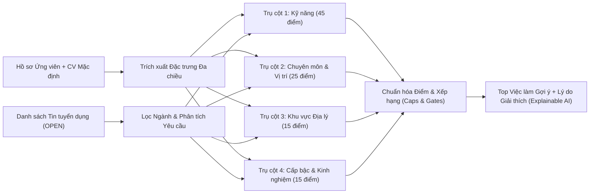

# Kiến Trúc Hệ Thống AI Gợi Ý Việc Làm Đa Chiều (Hybrid AI Recommendation Engine)

## 1. Tổng Quan Kiến Trúc

Hệ thống gợi ý việc làm của **TalentBridge** kết hợp giữa mạng nơ-ron học sâu **Dual-Tower PyTorch Bi-Encoder** (`talentbridge-ai-engine`) và **Bộ chấm điểm đa tiêu chí có kiểm soát chuẩn xác cao (4-Pillar Hybrid Scoring Pipeline)** trong `AiService` (`backend`). Kiến trúc này đảm bảo vừa hiểu ngữ nghĩa sâu sắc của hồ sơ ứng viên (Semantic Understanding), vừa tuân thủ nghiêm ngặt các ràng buộc thực tế trong tuyển dụng (Kỹ năng cốt lõi, Chuyên ngành hẹp, Khu vực địa lý và Cấp bậc thâm niên).

---

## 2. Trích Xuất Kỹ Năng Bằng Biểu Thức Chính Quy Ranh Giới Từ (Word-Boundary Regex Matching)

Để loại bỏ triệt để hiện tượng **dương tính giả do khớp chuỗi con (Substring False-Positive)** thường gặp ở các từ viết tắt ngắn (như `"c"`, `"r"`, `"go"`, `"ai"`, `"bi"`, `"hr"`, `"hrm"`), hệ thống sử dụng bộ khớp ranh giới từ thông minh `containsSkillKeyword(text, keyword)`:

$$\text{Pattern}(k) = \texttt{(?<![a-z0-9])} + \text{ quote}(k) + \texttt{(?![a-z0-9+#.])}$$

- **Ví dụ thực tế**:
  - Văn bản CV chứa `"Building HRM system with Java"` **không** bị nhận nhầm là kỹ năng nhân sự `"HR"` hay `"HR Business Partner"`.
  - Văn bản chứa `"C++ and C# programming"` **không** bị nhận nhầm là ngôn ngữ `"C"` thuần túy nếu ứng viên không liệt kê `"C"`.
  - Văn bản chứa `"Google Cloud"` hay `"MongoDB"` **không** bị nhận nhầm là ngôn ngữ `"Go"`.

---

## 3. Công Thức Chấm Điểm 4 Trụ Cột (4-Pillar Scoring Formula — Thang Điểm 100)

Tổng điểm tương thích trước chuẩn hóa $S_{\text{raw}} \in [0, 100]$ được tính từ 4 trụ cột độc lập:

$$S_{\text{raw}} = S_{\text{skills}} + S_{\text{title}} + S_{\text{location}} + S_{\text{experience}}$$

### 3.1 Trụ Cột 1: Độ Khớp Kỹ Năng Chuyên Môn ($S_{\text{skills}} \in [0, 45]$)
- Đối chiếu tập kỹ năng hợp nhất của ứng viên (từ Hồ sơ cá nhân + kỹ năng trích xuất tự động từ văn bản CV mặc định) với tập kỹ năng yêu cầu của tin tuyển dụng (`job.skills` + từ khóa kỹ thuật trong tiêu đề và mô tả).
- Công thức tính điểm:
  $$r_{\text{skill}} = \frac{|K_{\text{matched}}|}{|K_{\text{job}}|}, \quad S_{\text{skills}} = \min\left(45,\; \text{round}\left(r_{\text{skill}} \times 40 + \min(5,\; |K_{\text{matched}}| \times 1.25)\right)\right)$$

### 3.2 Trụ Cột 2: Độ Tương Đồng Vị Trí & Cổng Chuyên Môn Hẹp ($S_{\text{title}} \in [0, 25]$)
- Hệ thống phân loại tự động 12 nhóm chuyên môn kỹ thuật hẹp (**Specialization Families**): `backend`, `frontend`, `fullstack`, `mobile`, `data`, `ai_ml`, `devops`, `qa`, `security`, `ba_pm`, `design`, `embedded`.
- Nếu tin tuyển dụng yêu cầu một chuyên môn hẹp cụ thể (ví dụ `mobile` hoặc `data`) mà định hướng vị trí của ứng viên là chuyên môn khác (ví dụ `backend`) và không có kỹ năng chồng lấn, điểm $S_{\text{title}}$ sẽ bị giới hạn tối đa $\le 5$ điểm để tránh gợi ý chéo sai chuyên ngành.

### 3.3 Trụ Cột 3: Độ Ưu Tiên Khu Vực Địa Lý ($S_{\text{location}} \in [0, 15]$)
- Hệ thống xác định thành phố của ứng viên theo **thứ tự ưu tiên 5 tầng nghiêm ngặt (`CandidateCityResolution`)**:
  1. **`PROFILE` (Ưu tiên 1)**: Trường địa chỉ/thành phố do ứng viên khai báo trực tiếp trong Hồ sơ cá nhân (`candidateProfile.location`).
  2. **`CV_ADDRESS` (Ưu tiên 2)**: Dòng nhãn địa chỉ tường minh trong CV (`Địa chỉ:`, `Address:`, `Location:`, `Nơi ở:`).
  3. **`CV_HEADER` (Ưu tiên 3)**: Khu vực thông tin liên hệ ở 12 dòng đầu tiên của CV.
  4. **`CV_SCHOOL` (Ưu tiên 4 - Fallback)**: Suy luận từ tên trường đại học trong CV (chỉ kích hoạt khi cả 3 tầng trên đều không có thông tin địa chỉ).
  5. **`CV_MENTION` (Ưu tiên 5)**: Địa danh xuất hiện rải rác trong nội dung CV.
- **Thang điểm Khu vực**:
  - **Cùng thành phố (`SAME_CITY`)**: $+15 / 15$ điểm.
  - **Làm việc từ xa (`REMOTE`)**: $+12 / 15$ điểm.
  - **Chưa xác định địa điểm (`UNKNOWN`)**: $+8 / 15$ điểm.
  - **Khác thành phố (`DIFFERENT_CITY`)**: $0 / 15$ điểm (kèm cảnh báo rõ ràng trên thẻ gợi ý).

### 3.4 Trụ Cột 4: Mức Độ Phù Hợp Cấp Bậc & Kinh Nghiệm ($S_{\text{experience}} \in [0, 15]$)
- So sánh số năm kinh nghiệm và cấp bậc hiện tại của ứng viên (`INTERN`, `FRESHER`, `JUNIOR`, `MIDDLE`, `SENIOR`, `LEAD`) với yêu cầu của công việc (`job.experienceLevel`).
- Cùng cấp bậc hoặc chênh lệch $\le 1$ bậc hợp lý đạt $13 - 15$ điểm; ứng viên thiếu kinh nghiệm vượt quá 2 bậc (ví dụ `FRESHER` ứng tuyển `SENIOR`/`LEAD`) nhận $0 - 3$ điểm.

---

## 4. Cơ Chế Kiểm Soát Trần Điểm (Calibration Caps & Guardrails)

Nhằm ngăn chặn hiện tượng "lạm phát điểm AI" (inflated match scores), hệ thống áp dụng các ngưỡng trần bắt buộc trước khi trả kết quả:

1. **Trần thiếu hụt kỹ năng (`Low Skill Overlap Cap`)**:
   - Nếu $r_{\text{skill}} < 0.25$ (khớp dưới 25% kỹ năng yêu cầu): Điểm tối đa không vượt quá **45%**.
   - Nếu $|K_{\text{matched}}| = 0$: Điểm tối đa không vượt quá **30%**.
2. **Trần lệch cấp bậc (`Seniority Gap Cap`)**:
   - Nếu công việc yêu cầu cấp bậc cao hơn ứng viên từ 2 bậc trở lên (`SENIOR`/`LEAD` so với `INTERN`/`FRESHER`): Điểm tối đa bị giới hạn ở **52%**.
3. **Trần khác thành phố (`Cross-City Cap`)**:
   - Nếu công việc yêu cầu làm việc trực tiếp (`ONSITE`/`HYBRID`) tại thành phố khác với nơi ở của ứng viên: Điểm tối đa không vượt quá **68%** ngay cả khi khớp 100% kỹ năng.
4. **Phân Nhãn Trực Quan (`MatchLabel`)**:
   - `STRONG_MATCH` ($\ge 75\%$): Rất phù hợp — Ưu tiên ứng tuyển ngay.
   - `GOOD_MATCH` ($58\% - 74\%$): Phù hợp tốt.
   - `POTENTIAL_MATCH` ($40\% - 57\%$): Tiềm năng — Cần bổ sung một số kỹ năng hoặc cân nhắc khu vực.
